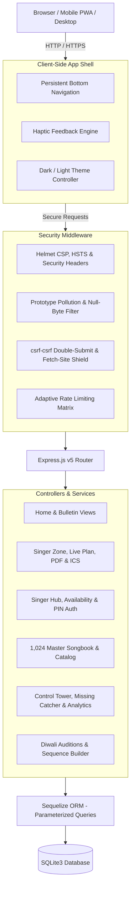

# 🕉️ Bhajan Scheduler & Planner

[](https://nodejs.org/)
[](https://expressjs.com/)
[](https://www.sqlite.org/)
[](#-pwa--offline-capabilities)
[](#-security-architecture)
[](#-deployment-railway)
[](package.json)

> A modern, ultra-fast, security-hardened Progressive Web Application (PWA) engineered with native-first ergonomics, micro-haptics, and instant zero-reload tab switching for scheduling and curating devotional bhajan sessions for the **Sri Sathya Sai Seva Organisation, Gandhinagar**.

---

## 📌 Table of Contents

- [Overview](#-overview)
- [Key Features](#-key-features)
- [Tech Stack](#-tech-stack)
- [Application Architecture](#-application-architecture)
- [Directory Structure](#-directory-structure)
- [Security Architecture](#-security-architecture)
- [Performance & Memory Optimizations](#-performance--memory-optimizations)
- [Quick Start](#-quick-start)
- [Environment Variables](#-environment-variables)
- [Route Navigation Map](#-route-navigation-map)
- [PWA & Offline Capabilities](#-pwa--offline-capabilities)
- [Testing & CI](#-testing--ci)
- [Deployment (Railway)](#-deployment-railway)
- [License](#-license)

---

## 🕉️ Overview

**Bhajan Scheduler** is an end-to-end devotional session management platform. Designed specifically for Sri Sathya Sai Seva Organisations, it unites coordinators, accompanists, devotee singers, and attendees into a unified digital workspace.

Featuring an **App-First Shell Architecture**, the application delivers a seamless mobile app experience in the browser—with persistent bottom navigation, zero-reload tab switching, physical micro-haptic feedback, verified Prashanti Mandir lyrics, official sheet music, acoustic tanpura auditioning, timestamped session recordings, server-generated PDF/calendar exports, Diwali audition sequencing, and a defense-in-depth security perimeter.

---

## ✨ Key Features

### 📱 1. App-First Shell & Zero-Reload Tab Switching
- **Persistent Bottom Navigation & Detail Sheet**: Instant navigation across `Home`, `Singer Zone`, `Songbook`, `Live Plan`, `My Hub`, and `Admin`, with dedicated slide-over detail sheets.
- **Zero-Reload State Persistence**: Tab switching preserves user input, scroll position, and search queries without full-page reloads.
- **Lazy Tab Initialization**: Only the active pane boots on launch; background tabs initialize on demand.

### 📳 2. Native Tactile Micro-Haptics
- **Web Vibration Engine (`haptics.js`)**: Calibrated tactile tap feedback for mobile browsers and installed PWAs across navigation tabs, toggles, deity pills, and form submissions.

### 🎤 3. Devotee Singer Zone & Personal Singer Hub (`/my-hub`)
- **PIN-Protected Accounts**: Devotees sign in with a 4-digit PIN hashed using `bcrypt` with database-backed 5-attempt / 15-minute lockout protection and constant-time dummy verification.
- **Upcoming Thursday Availability**: Singers can toggle upcoming Thursdays between **Available** and **Traveling**, surfacing travel conflicts directly in the Admin Sequencer.
- **Personal Repertoire & Scale Management**: Manage preferred vocal scales (Indian & Western notation), personal songbook bookmarks, submission history, and past audio recordings.

### 📖 4. 1,024 Curated Prashanti Mandir Bhajans (`/master-bank`)
- **Curated Official Catalog**: 1,024 Prashanti Mandir bhajans with Devanagari and transliterated lyrics, raga classifications, tempo, suggested male/female shrutis, and official sheet music PDFs.
- **Compact Catalog & Fast Client Search**: Public `/api/master-bhajans/catalog.json` endpoint omits raw lyrics (`has_lyrics` flag + `/api/bhajan/:id/lyrics` on-demand modal) for lightweight loading and instant in-memory filtering.
- **Role-Scoped Master Bank Controls**: Regular Admins can edit catalog entries and reconcile missing titles, while creating or archiving/deleting canonical Master Bank bhajans is restricted to Super Admins.

### 📊 5. Live Session Plan, Exports & Accompanist Tools (`/plan-view`)
- **Live Sequence Board & Print View**: Displays ordered deities, lead & partner singers, vocal scales (Indian + Western key), tempos, and ragas, with clean portrait A4 print styling and accompanist cue footers.
- **Server-Side PDF & Calendar Exports**: Download handcrafted A4 schedule PDFs via `/plan-view/pdf` (`pdfkit`) or add the Thursday evening session (IST `VTIMEZONE` + 1-hour reminder) to phone calendars via `/plan-view/session.ics`.
- **Acoustic Tanpura Drone & Timestamped Session Audio**: Audition vocal pitch directly inside the submission form with the built-in Tanpura drone widget, and stream published Thursday recordings from Cloudflare R2 with clickable per-bhajan timestamps.

### 🪔 6. Admin Control Tower, Sequencer Diagnostics & Diwali Module (`/admin`)
- **Session Sequencer & Diagnostics**: Drag-and-drop sequence ordering, copy/import sessions, deity rule enforcement, 1-tap **WhatsApp Open-Slot Reminder** on the dashboard, and automated warnings for back-to-back singers, consecutive deity repeats, repeated ragas, 2-session repertoire cooldown, and singer travel conflicts.
- **Simplified Missing Bhajan Catcher (`/admin/missing-bhajans`)**: Live Master Bank search per unmatched submission title to link canonical entries quickly without noisy false-positive fuzzy matches.
- **Singer Directory CSV Tools (`/admin/singers`)**: Bulk CSV import (`Name,Gender,Preferred Scale`), spreadsheet-formula-safe CSV export (`/admin/singers/export.csv`), and 1-click inline gender completion.
- **Diwali Audition & Sequence Management (`/admin/diwali`)**: Super-Admin module supporting Excel audition imports, independent per-bhajan pair assignment, automatic + manual sequence building, touch/desktop cross-sequence drag-and-drop, Morning/Evening session periods, Harmonium & Tabla accompanist tracking, and Gujarat-branded portrait/landscape PDF & Excel exports.
- **Analytics & Activity Audit**: Largest-remainder normalized tempo/deity analytics (`/admin/analytics`) and buffered user presence/audit logging (`/admin/activity-logs`).

### 🔔 7. Real-Time Notification Center & Samiti Bulletins
- **Web Push & In-App Alerts**: VAPID Web Push notifications and unread tracking for session openings, reminders, and finalized plans.
- **Notice Board & Ticket Tracking (`/bulletins`, `/my-reports`)**: Samiti announcements with published date previews plus devotee issue/suggestion tickets.

### 🌙 8. Universal Dark & Light Night Mode
- **Dual Visual Theme System**: Warm saffron/paper daylight palette and low-glare obsidian dark mode with anti-FOUC initialization before first paint.

---

## 🛠️ Tech Stack

### Backend & Core
- **Runtime**: [Node.js](https://nodejs.org/) (v18+, CI tested on 18.x, 20.x, 22.x)
- **Server Framework**: [Express.js](https://expressjs.com/) v5 (`express-ejs-layouts`)
- **Database & Sessions**: [SQLite3](https://www.sqlite.org/) with [Sequelize ORM](https://sequelize.org/) and `connect-session-sequelize` persistent `Sessions` store
- **Authentication & Security**: `bcrypt` (12 rounds for Admin passwords, 10 rounds for Singer PINs), Google OAuth 2.0 (`google-auth-library`), `helmet`, `csrf-csrf`, `cookie-parser`
- **Exports, Imports & Media**: `pdfkit`, `exceljs`, `csv-parser`, `multer`, `@aws-sdk/client-s3` (Cloudflare R2), `web-push`, `compression`, `pino` / `pino-pretty`

### Frontend, Testing & Tooling
- **Frontend**: Server-rendered EJS templates, Single-DOM App Shell router (`app-shell-router.js`), layered pure CSS (`@layer base, components, layout, overrides`), Web Vibration haptics, Web Audio Tanpura drone, and Service Worker (`sw.js`)
- **Testing & Quality**: Node built-in test runner (`node --test`), `supertest`, `eslint` v9, `prettier`

---

## 🏗️ Application Architecture



---

## 📁 Directory Structure

```
Bhajan_Schedular/
├── .github/workflows/ci.yml       # GitHub Actions lint & test workflow (Node 18.x, 20.x, 22.x)
├── app.js                         # Express v5 entry point, security middleware, layouts & routing
├── package.json                   # Dependencies, Node engine >=18.0.0, scripts
├── railway.json                   # Railway Nixpacks build & /healthz deploy config
├── eslint.config.js               # ESLint v9 flat configuration
├── templates.js                   # HTML escape & shared template helpers
├── master_bhajans.json            # Curated catalog of 1,024 Prashanti Mandir bhajans
├── config/                        # Sequelize SQLite configuration
├── controllers/                   # Route handlers (admin, adminUser, activity, analytics, api, auth,
│                                  #   bulletin, diwali, home, masterBank, notification, planner,
│                                  #   report, sessionAudio, singer, singerHub)
├── data/                          # Tracked reference data & seed assets
├── docs/                          # Project documentation
├── middleware/                    # auth, authLocals, csrfProtection, security, singerAuth, activityTracker
├── models/                        # Sequelize models (BhajanSubmission, MasterBhajan, Singer, AdminUser,
│                                  #   DeityRule, SessionMeta, SessionPermission, SessionAudio,
│                                  #   SessionAudioTimestamp, Bulletin, Notification, NotificationRead,
│                                  #   PushSubscription, BhajanReport, SingerBookmark, ActivityLog,
│                                  #   UserPresence, DiwaliEvent/Participant/Bhajan/Sequence/Entry)
├── public/                        # Static assets
│   ├── css/                       # Layered stylesheets (style.css, app-shell.css, admin.css, native.css, etc.)
│   ├── js/                        # Client modules (app-shell-router.js, script.js, diwali.js, pwa.js,
│   │                              #   notifications.js, tanpura.js, session-audio-player.js, haptics.js, etc.)
│   ├── sheets/                    # Official musical notation PDFs
│   ├── images/                    # App icons (including /images/icons/dev/) and logos
│   ├── manifest.json              # Production Web App Manifest
│   ├── manifest.dev.json          # Isolated Development Web App Manifest (Bhajan Planner DEV)
│   ├── sw.js                      # Variant-aware Service Worker & Web Push handler
│   └── offline.html               # Offline fallback page
├── routes/                        # Express routers (admin, adminUsers, analytics, api, auth, bulletin,
│                                  #   diwali, home, masterBank, notifications, planner, reports,
│                                  #   singer, singerHub)
├── scripts/                       # Seeding, migration, import & integrity maintenance scripts
├── services/                      # Business logic (databaseInitializer, catalogCache, plannerService,
│                                  #   sessionPdfService, diwaliService, diwaliExportService,
│                                  #   audioStorageService, backupService, pwaConfig, validators, etc.)
├── tests/                         # Tracked node:test + supertest automated test suite
└── views/                         # EJS templates, layouts/, partials/, and diwali/ views
```

---

## 🔒 Security Architecture

1. **HTTP Security Headers (`helmet` & `securityHeaders`)**:
   - Content Security Policy restricting scripts, styles, fonts, frames, and workers; `Strict-Transport-Security` in production; `X-Content-Type-Options: nosniff`; `X-Frame-Options: SAMEORIGIN`; `Cross-Origin-Opener-Policy: same-origin-allow-popups` for Google Sign-In.
2. **Deep Prototype Pollution & Null-Byte Sanitization**:
   - Recursively strips `__proto__`, `constructor`, `prototype`, and `\0` null bytes across `req.body`, `req.query`, and `req.params`.
3. **CSRF & Cross-Site Write Shield**:
   - Double-submit CSRF tokens via `csrf-csrf` (`ps_csrf` & `ps_csrf_uid` `httpOnly` cookies) decoupled from session IDs so login regeneration preserves open-tab tokens, combined with `Sec-Fetch-Site` and `Origin` vs. `Host` checks.
4. **XSS-Safe Serialization & CSV Formula Neutralization**:
   - `safeJson()` escapes `<`, `>`, `&`, and Unicode line/paragraph separators inside inline `<script>` tags; admin singer CSV exports neutralize `=`, `+`, `-`, `@` formula prefixes.
5. **Adaptive Rate Limiting Matrix**:
   - Dedicated rate limits on admin/OAuth logins (`authLimit`: 20 / 15 min), singer PIN attempts (`singerLoginLimit`: 15 / 15 min), PIN changes (`10 / 15 min`), bhajan submissions (`30 / 5 min`), reports (`25 / 30 min`), and general writes (`1500 / 15 min`).
6. **Authentication & Session Persistence**:
   - `bcrypt` hashing for Admin accounts (12 rounds) and 4-digit Singer PINs (10 rounds + 5-failure / 15-minute account lockouts), `httpOnly` + `SameSite=Lax` cookies backed by SQLite `Sessions` table.
7. **SQL Injection Immunity & Strict Validation**:
   - Parameterized Sequelize queries and strict payload/date validators (`validateAdminSubmissionEdit`, `isValidCalendarDate`, etc.).

---

## ⚡ Performance & Memory Optimizations

- **Lazy Tab Initialization**: Only the active App Shell tab boots initially; secondary panes mount on demand.
- **Lean Master Catalog & On-Demand Lyrics**: `/master-bank` renders an initial SSR window and loads compact metadata (`/api/master-bhajans/catalog.json`) without inline lyric blobs, fetching full lyrics asynchronously when opened.
- **In-Memory Caching & SQLite Indexes**: Cached Master Catalog, singer directory, missing count, and indexed SQLite lookups (`session_permissions`, `session_audios`, `admin_users`, `diwali_*`, `Sessions`).
- **Buffered Activity Telemetry**: Activity logs buffer in memory and flush in batches with bounded queries.

---

## 🚀 Quick Start

### Prerequisites
- **Node.js**: `v18.0.0` or higher
- **npm**: `v9.0.0` or higher

### Installation & Run

1. **Clone the repository:**
   ```bash
   git clone https://github.com/Prashant1694/Bhajan_Schedular.git
   cd Bhajan_Schedular
   ```

2. **Install dependencies:**
   ```bash
   npm install
   ```

3. **Configure environment variables:**
   ```bash
   cp .env.example .env
   ```
   *Edit `.env` to configure admin credentials, `SESSION_SECRET`, `CSRF_SECRET`, and optional integrations.*

4. **Start the application:**
   - **Development Mode** (auto-reload with `nodemon`):
     ```bash
     npm run dev
     ```
   - **Production Mode**:
     ```bash
     npm start
     ```

5. **Open the app:**
   Visit [http://localhost:8000](http://localhost:8000).

---

## 🔑 Environment Variables

| Variable | Required | Default | Description |
| :--- | :---: | :---: | :--- |
| `PORT` | ❌ | `8000` | HTTP port for the Express server. |
| `NODE_ENV` | ❌ | `development` | Set to `production` in live environments (`test` for test runs). |
| `TZ` | ❌ | `Asia/Kolkata` | Server timezone used for session dates and `.ics` schedules. |
| `SESSION_SECRET` | ✅ *(prod)* | *Fallback in dev* | Signing secret for sessions & cookies (`>= 32` chars required in production). |
| `CSRF_SECRET` | ❌ | `SESSION_SECRET` | Secret for `csrf-csrf` double-submit token generation (`>= 32` chars recommended). |
| `SUPER_ADMIN_USER` | ❌ | `admin` | Initial Super Admin username seeded on first startup. |
| `SUPER_ADMIN_PASS` | ❌ | `admin123` | Initial Super Admin password seeded on first startup. |
| `SUPER_ADMIN_DISPLAY_NAME` | ❌ | `Super Admin` | Display name for the seeded Super Admin account. |
| `SUPER_ADMIN_GOOGLE_EMAIL` | ❌ | - | Optional Google email bound to the seeded Super Admin account. |
| `DB_PATH` | ❌ | `./bhajans.db` | Path to the SQLite database file (set `/data/bhajans.db` on Railway). |
| `GOOGLE_CLIENT_ID` | ❌ | - | Google OAuth 2.0 Client ID for admin Sign-In & recovery. |
| `GOOGLE_ALLOW_LOCALHOST` | ❌ | `false` | Set `true` to allow Google Sign-In buttons on `localhost` / `127.0.0.1`. |
| `PWA_APP_VARIANT` | ❌ | *Auto-detected* | Explicit `production` or `development` override (auto-detects `RAILWAY_GIT_BRANCH`, dev hostnames, etc.). |
| `VAPID_PUBLIC_KEY` | ❌ | - | VAPID public key for Web Push notifications. |
| `VAPID_PRIVATE_KEY` | ❌ | - | VAPID private key for Web Push notifications. |
| `VAPID_SUBJECT` | ❌ | - | `mailto:` or URL subject identity for Web Push. |
| `CLOUDFLARE_R2_ACCOUNT_ID` | ❌ | - | Cloudflare R2 account ID for session audio uploads/listing. |
| `CLOUDFLARE_R2_ACCESS_KEY_ID` | ❌ | - | Cloudflare R2 S3-compatible access key ID. |
| `CLOUDFLARE_R2_SECRET_ACCESS_KEY` | ❌ | - | Cloudflare R2 S3-compatible secret access key. |
| `CLOUDFLARE_R2_BUCKET_NAME` | ❌ | - | Cloudflare R2 bucket name storing session audio files. |
| `CLOUDFLARE_R2_PUBLIC_URL` | ❌ | - | Public CDN base URL for streaming session audio recordings. |

---

## 🗺️ Route Navigation Map

| Section | Route Path | Description |
| :--- | :--- | :--- |
| **App Shell** | `/` | Native App Shell with persistent tabs, top bar, and bottom navigation. |
| **Singer Zone** | `/submit-form` | Devotee bhajan submission form with autocomplete, deity rules, and Tanpura drone. |
| **Songbook** | `/master-bank` | 1,024 Prashanti Mandir Bhajans with lyrics, music sheets, and ragas. |
| **Live Plan** | `/plan-view` | Public live program sequence, WhatsApp share text, and print layout. |
| **Live Plan PDF** | `/plan-view/pdf` | Clean server-rendered A4 PDF export of the selected session plan. |
| **Calendar Event** | `/plan-view/session.ics` | Downloadable `.ics` calendar invite (`Asia/Kolkata`) with 1-hour reminder. |
| **My Hub** | `/my-hub` | Devotee hub, Thursday travel availability toggles, preferred scale, and songbook. |
| **History** | `/database` | Historical session archives with search and song breakdowns. |
| **Bulletins** | `/bulletins` | Samiti announcements, festival notices, and circulars. |
| **Notifications & Tickets** | `/notification-settings`, `/my-reports` | Web Push subscription management and issue ticket tracking. |
| **Admin Portal** | `/admin` | Control Tower calendar, open-slot reminder, and session links. |
| **Session Sequencer** | `/admin/date/:date` | Drag-and-drop sequence ordering, diagnostics, audio timestamps, and lock toggles. |
| **Missing Catcher** | `/admin/missing-bhajans` | Reconcile uncataloged submission titles via live Master Bank search. |
| **Singer Directory** | `/admin/singers` | Singer roster, PIN management, CSV import/export, and quick gender updates. |
| **Deity Rules & Analytics** | `/admin/rules`, `/admin/analytics`, `/admin/activity-logs` | Deity limits, normalized analytics, and presence/audit monitor. |
| **Diwali Module** | `/admin/diwali` | Super-Admin Diwali audition import, pair editing, sequence editor, and exports. |
| **User Access** | `/admin/admin-users` | Super-Admin account and role management. |
| **Healthcheck** | `/healthz` | Database connectivity and process memory status for Railway monitoring. |

---

## 📱 PWA & Offline Capabilities

- **Branch-Aware Prod/Dev Isolation (`services/pwaConfig.js`)**: Automatically serves `manifest.dev.json`, distinct `Bhajan Planner DEV` icons (`/images/icons/dev/*`), and a separate `bhajan-planner-dev-*` Service Worker cache namespace on development branches/hostnames without affecting `main` production installs.
- **Safe Caching Strategy (`public/sw.js`)**:
  - Network-first for CSS/JS, general document navigation, and `/plan-view` / `/master-bank` (caching only unauthenticated HTML snapshots for offline fallback).
  - Stale-while-revalidate for public devotional read JSON (`/api/master-bhajans/catalog.json` and `/api/bhajan/:id/lyrics`), never caching private singer or admin endpoints.
  - Cache-first for fonts, static images, and `/audio/tanpura/` drone samples, with `offline.html` fallback when completely offline.

---

## 🧪 Testing & CI

- **Run ESLint:**
  ```bash
  npm run lint
  ```
- **Run full automated test suite** (uses isolated temporary SQLite databases in `os.tmpdir()` via `tests/setup.js`):
  ```bash
  npm test
  ```
  or explicitly matching CI:
  ```bash
  NODE_ENV=test node --test tests/*.test.js
  ```
- **Continuous Integration**: `.github/workflows/ci.yml` runs `npm ci`, `npm run lint`, and `node --test tests/*.test.js` across Node.js `18.x`, `20.x`, and `22.x` on pushes and PRs to `main` and `develop`.

---

## ☁️ Deployment (Railway)

The repository includes `railway.json` configured for Nixpacks deployment:

1. **Connect Repository** to Railway (`main` for production, `develop` for staging/dev).
2. **Mount Persistent Volume** at `/data` and set `DB_PATH=/data/bhajans.db`.
3. **Configure Environment Variables**:
   - Set `NODE_ENV=production` and strong `SESSION_SECRET` / `CSRF_SECRET` values (`>= 32` chars).
   - Set `SUPER_ADMIN_USER` and `SUPER_ADMIN_PASS` (plus optional Google OAuth, VAPID, and Cloudflare R2 variables).
   - `main` automatically resolves to the production PWA manifest/icons; set `PWA_APP_VARIANT=production` or `development` if overriding explicitly.
4. **Health Check**: Railway monitors `/healthz` for database and container readiness.

---

## 📄 License

Distributed under the **ISC License**. See [package.json](package.json) for details.

---

<p align="center">
  <i>Dedicated with love and reverence to Bhagawan Sri Sathya Sai Baba • Sri Sathya Sai Seva Organisation, Gandhinagar 🕉️</i>
</p>
